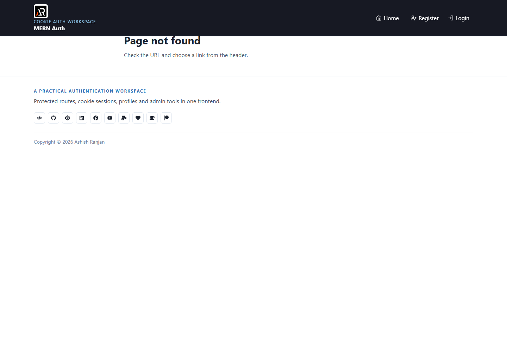

# MERN Auth Chakra Frontend

React and Vite client for the companion [Express and MongoDB API](https://github.com/a2rp/mern-auth-chakra-backend). It uses HttpOnly cookie sessions for protected routes, profile management, and role-based admin tools.



## Features

- Register, login, dashboard, profile, and protected routes
- HttpOnly cookie sessions restored through the API
- Profile and password management
- Admin user search, pagination, sorting, and role updates
- Responsive Chakra UI interface

## Run locally

Copy `.env.example` to `.env.local`, then start the backend and frontend in separate terminals:

```bash
npm ci
npm run dev
```

`VITE_API_URL` defaults to `http://localhost:1198`. It should contain the backend origin without `/api`, for example `https://api.example.com`. The backend must allow the frontend origin in `FRONTEND_URL`.

## Routes

- `/` — overview
- `/register` — create an account
- `/login` — sign in
- `/dashboard` — protected dashboard
- `/profile` — protected profile and password settings
- `/admin` — admin-only user management

## GitHub Pages deployment

Set `VITE_API_URL` at build time to the deployed API origin, then run `npm run deploy`. The backend must allow `https://a2rp.github.io` in `FRONTEND_URL`, run over HTTPS, and set `COOKIE_SAME_SITE=none` so cross-site browser requests can send the HttpOnly session cookie. See the backend README for its cookie and CORS settings.

## Links

- [Portfolio](https://www.ashishranjan.net)
- [GitHub](https://github.com/a2rp)
- [CodePen](https://codepen.io/ash1198)
- [LinkedIn](https://www.linkedin.com/in/aashishranjan)
- [Facebook](https://www.facebook.com/theash.ashish/)
- [YouTube](https://www.youtube.com/@ashishranjan-ashz?sub_confirmation=1)
- [Email](mailto:ash.ranjan09@gmail.com)
- [Support](https://a2rp-donation-page.netlify.app/)
- [Buy Me a Coffee](https://buymeacoffee.com/a2rp)
- [Patreon](https://patreon.com/a2rp)
